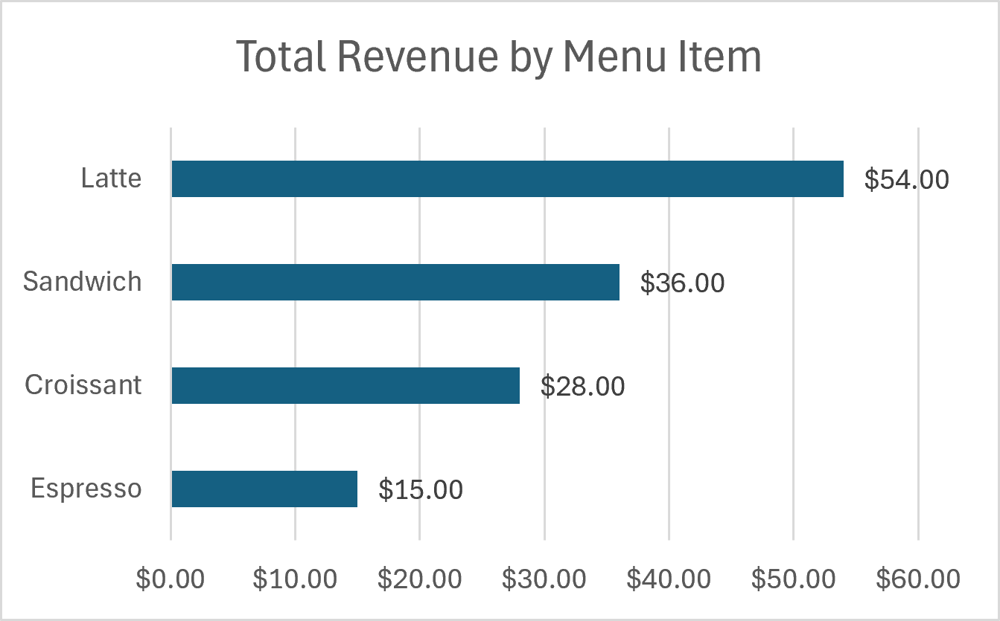
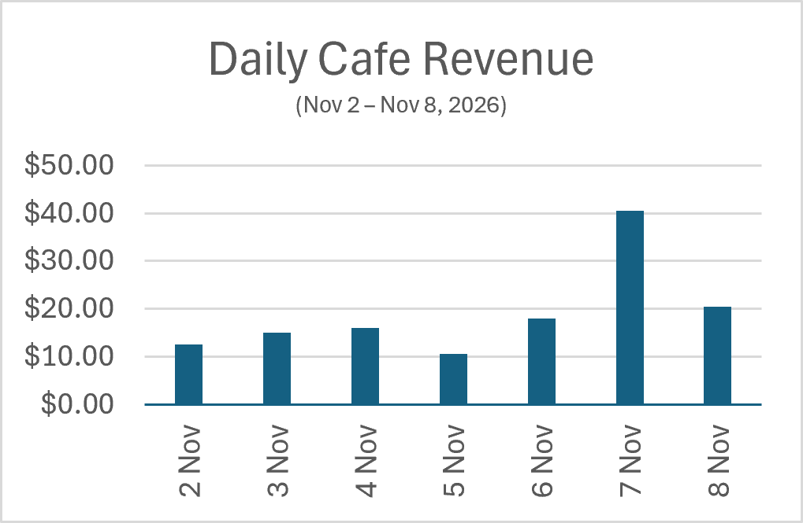

# Weekly Cafe Sales Analysis (Nov 2 – Nov 8, 2026)

An end-to-end exploratory sales analysis built in **Microsoft Excel** using **Power Query (ETL)** and **Pivot Tables** to evaluate weekly menu performance, daily traffic trends, and customer payment preferences.

---

## Top-Line KPIs

| Metric | Result | Context |
| :--- | :--- | :--- |
| **Total Weekly Revenue** | **$133.00** | Across 7 operating days (Mon–Sun) |
| **Total Orders & Volume** | **15 Orders** | 31 total units sold ($8.87 avg. order value) |
| **Top Revenue Generator** | **Latte ($54.00)** | 12 units sold — **40.6%** of total weekly revenue |

---

## Key Findings & Visual Breakdown

### 1. Menu Performance (Volume vs. Value)

* **Latte dominates both volume and revenue:** Sold 12 units at $4.50 each, generating **$54.00** (40.6% of all sales).
* **Higher unit prices beat higher unit counts:** **Sandwich** ranked #2 in revenue (**$36.00** from 6 units at $6.00) despite selling fewer units than **Croissant** (**$28.00** from 8 units at $3.50). **Espresso** ranked fourth (**$15.00** from 5 units).

### 2. Daily Revenue Trend (Weekday vs. Weekend)

* **Strong weekend surge:** Weekend sales (Saturday **$40.50** + Sunday **$20.50**) generated **$61.00**, accounting for **45.9%** of the entire week's revenue in just two days.
* **Mid-week dip:** Thursday was the slowest operating day at **$10.50** (only 2 orders).

### 3. Payment Method Preference
| Payment Method | Total Revenue | Share of Revenue | Order Count |
| :--- | :---: | :---: | :---: |
| **Digital Wallet** | $73.00 | 54.9% | 7 |
| **Card** | $49.50 | 37.2% | 6 |
| **Cash** | $10.50 | 7.9% | 2 |
| **Grand Total** | **$133.00** | **100.0%** | **15** |

* **92.1% of revenue is cashless:** Digital Wallet is the primary payment choice (7 of 15 orders), while Cash was used exclusively for small Croissant purchases.

---

## Data Cleaning & Methodology (Power Query ETL)
All transformations were automated inside Excel Power Query so future weekly CSV exports refresh with one click:
1. **Text Standardization:** Standardized inconsistent casing in `ORD-05` (`"latte"` $\rightarrow$ `"Latte"`) so beverage revenue aggregated accurately.
2. **Missing Value Imputation:** Imputed the missing `Quantity` on `ORD-08` (Sandwich) as `1` unit to preserve all 15 customer transactions without inflating volume.
3. **Feature Engineering:** Created a calculated `Total_Sales` column (`[Quantity] * [Unit_Price]`) formatted as currency prior to Pivot Table aggregation.

---

## Actionable Recommendations
1. **Optimize Weekend Staffing & Prep:** Schedule peak barista and kitchen coverage for **Saturday and Sunday** (when daily sales jump up to 3.8x Thursday's volume) and pre-prep high-margin **Sandwiches** and **Lattes** ahead of the Saturday rush.
2. **Launch a Mid-Week Bundle Deal:** Introduce a **Thursday "Latte + Croissant" combo for $7.00** (down from $8.00 à la carte) to lift order volume on the slowest day of the week while pairing the #1 beverage with the #2 unit-volume pastry.